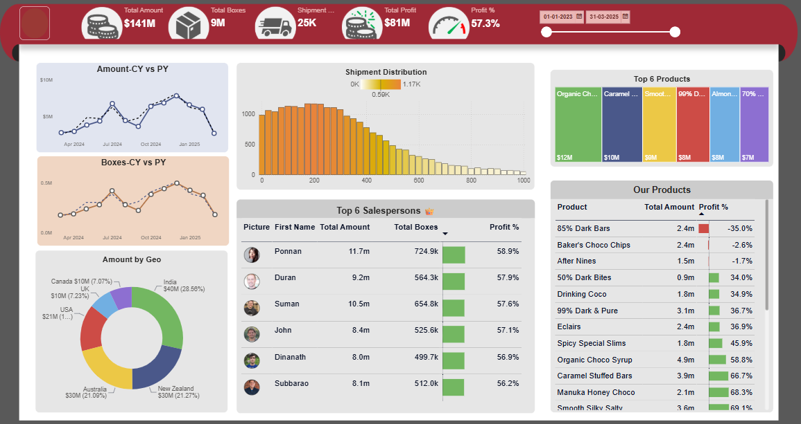

# Sales and Shipment Analytics Dashboard — Chocolate Sales

A Power BI dashboard that turns 25,076 chocolate shipment records into clear, decision-ready sales and shipment insights.

## What this dashboard answers

- How much are we selling, and how many boxes are we shipping?
- How is this year performing against last year — in both sales amount and boxes shipped?
- Which products and salespeople are driving the business?
- Where is demand concentrated by country?

## Key findings

- **$141.49 million** in total sales across **25,076 shipments**
- **8.83 million boxes** shipped
- **India is the largest market: $40 million, 28.58% of sales**, followed by New Zealand and Australia at $30 million each
- Top 6 products and top 6 salespeople are ranked on the dashboard, with profitability ranging from 85% Dark Bars at −35.0% to Smooth Silky Salty at 69.1%
- Year-on-year comparison (CY vs PY) is shown for both sales amount and boxes shipped

## Tools used

- **Microsoft Power BI** — dashboard design and visuals
- **DAX** — KPI measures and year-on-year calculations
- **Power Query** — data cleaning and shaping

## Files

| File | Description |
| --- | --- |
| `chocolate-sales-analytics-dashboard.pbix` | The complete Power BI file — open it in Power BI Desktop to explore the dashboard, measures, and data model |
| `chocolate-sales-dashboard.png` | Dashboard screenshot |

## How to open it

1. Download `chocolate-sales-analytics-dashboard.pbix`
2. Open it in Microsoft Power BI Desktop (free)
3. Use the slicers to filter by product, salesperson, and country

## About me

**Dinesh Karthik** — Aspiring Data Analyst | SQL · Power BI · Python · Excel

Final-year B.Tech Computer Science student, graduating 2027, seeking entry-level Data Analyst roles in India.

- LinkedIn: https://www.linkedin.com/in/dinesh-karthik-732a882bb/
- Portfolio: https://portfilo-lime-two.vercel.app/
- GitHub: https://github.com/dineshkarthik14322
